# 围墙棋 Quoridor Walls

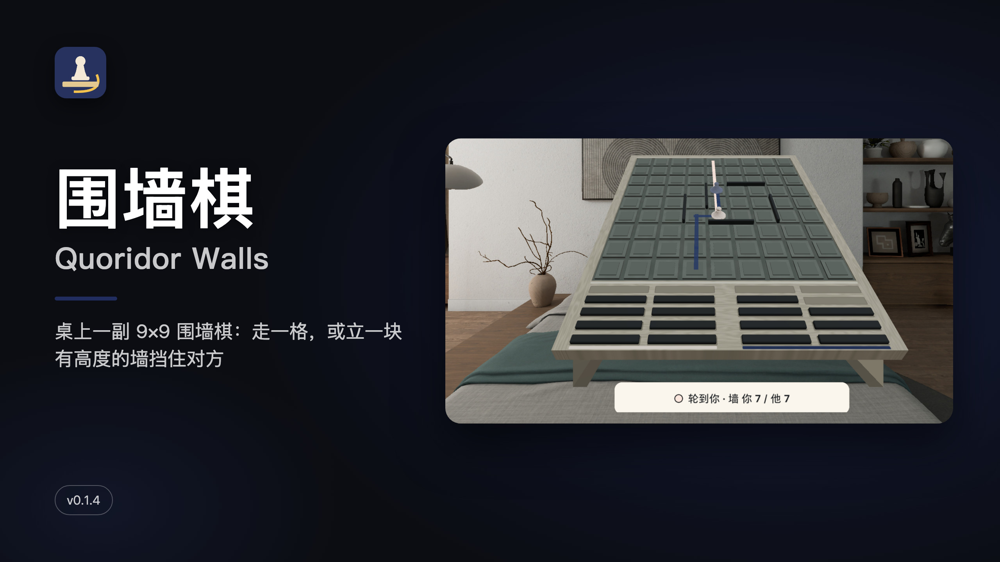

[中文](#中文) · [English](#english)

## 中文

桌上摆一副 1:1 的 9×9 围墙棋（Quoridor）。你的子要先走到对面底线；每回合二选一：走一格，或者从手边托盘里拿一块墙立进格间的槽里挡住对方。墙是有高度的实体，立起来就真的挡路；但不能把对方彻底堵死，那样整块墙会变红弹回。

PICO OS 6 Shared Space 应用（PICO Spatial SDK 6.1.9），一个体积窗口放棋盘，右边一块控制窗。

### 截图

| | |
|---|---|
| 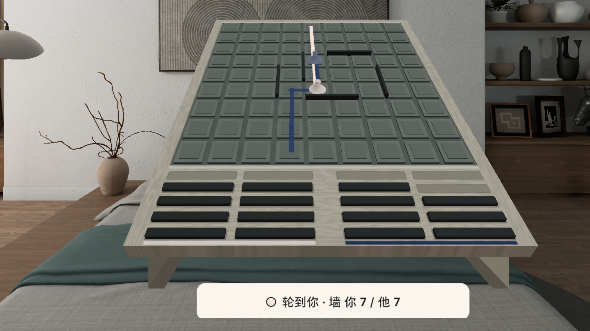 对局中：两条最短路光带显示你和对方各还差几步 | 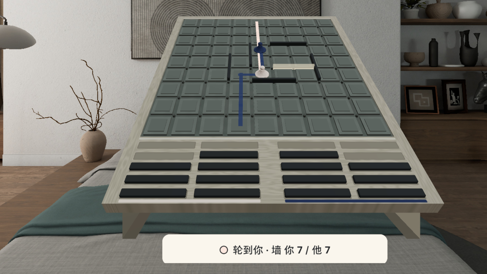 点手边托盘拿起一块墙，点一个槽就出现绿色预览 |
| 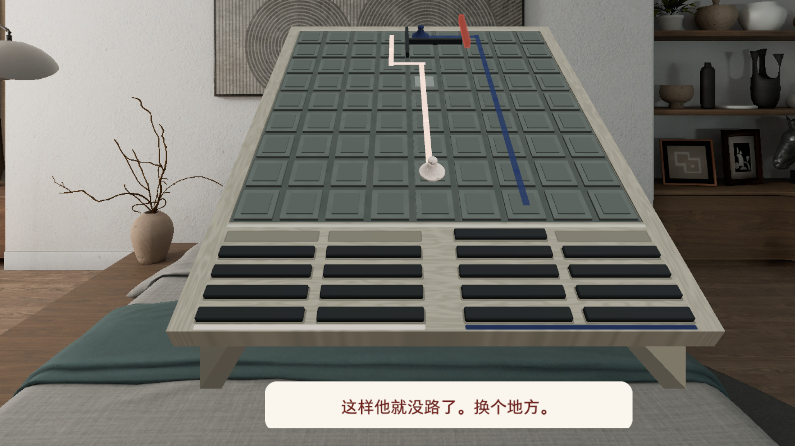 这块墙会把对方彻底堵死：整块变红弹回 | 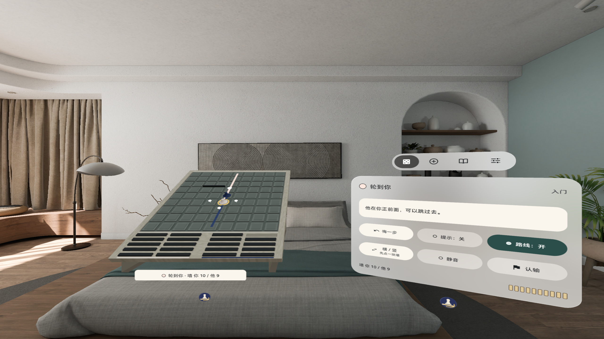 选中自己的子：对方在正前方，可以跳过去 |
| 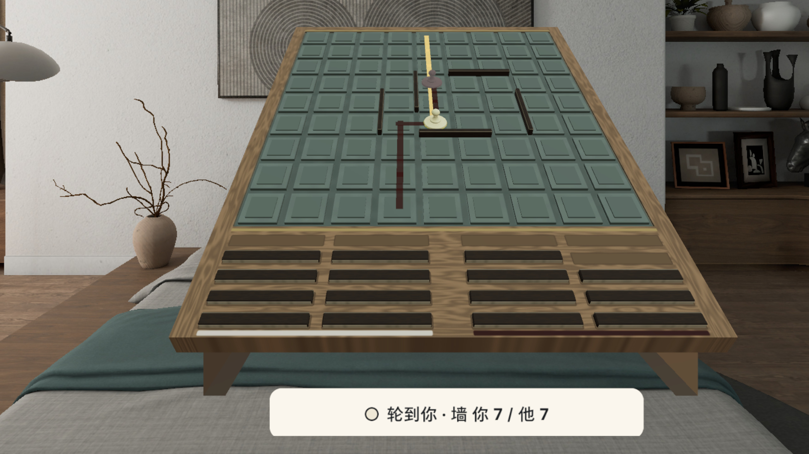 古典皮肤：青瓷格面、象牙 / 朱砂子、胡桃木墙 | 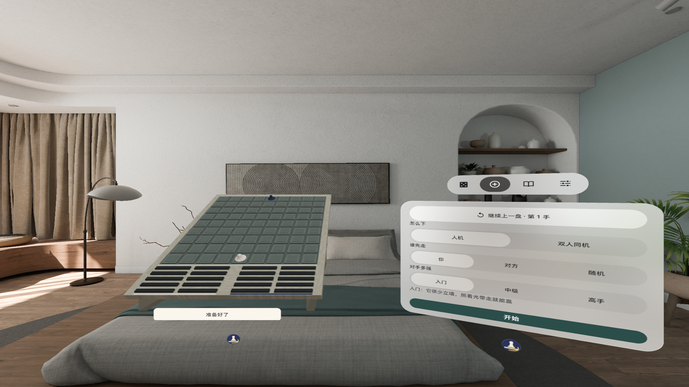 新局：人机三档难度，或双人同机 |

截图在模拟器上拍，3D 操作由调试广播驱动，**非真实手势录像**。

### 怎么下

- 点亮着的格子走一步；对方挡在正前方时可以跳过去（后面有墙就斜跳）
- 点手边托盘拿起一块墙，盘上亮出所有槽位；点一个槽看预览（绿 = 能放，红 = 不行），再点一次或按 [放下] 立墙；[横 / 竖] 转向；也可以按住托盘直接拖
- 电脑对手入门 / 中级 / 高手三档；或者「双人同机」两个人轮流用同一台头显，自己和自己下也行
- 悔一步、提示、首局手把手；退出时自动存盘，下次接着下
- 两套皮肤（现代 / 古典），中明度哑光 PBR，跟随系统环境光
- 手势捏合、眼动 + 捏合、手柄射线都能下；中英双语；全部本机运行，不联网、不需要账号

### 安装

Release 里的 APK 是 `assembleRelease` 出的未签名包（上架用），自己装请先签名，或从源码构建 debug 包：

```bash
export JAVA_HOME=~/.pico/primer-cli/jdk/jdk-21.0.13+9/Contents/Home   # 任意 JDK 17+
./gradlew assembleDebug
adb install -r app/build/outputs/apk/debug/app-debug.apk
pico-cli app launch io.embodit.quoridorwalls
```

已知问题：暗室（环境光很暗）下落点标记和格面的对比度没有专门复测；手柄副键转墙、拖子走棋没做（用 [横 / 竖] 和点按）。

## English

A life-size 9×9 Quoridor board on your table. Race your pawn to the far side; each turn either step one cell, or take a wall from the tray in front of you and stand it in a groove to block your opponent. Walls are solid and have height; you may never shut the other side in completely: a wall that would do so turns red and bounces back.

A PICO OS 6 Shared Space app (PICO Spatial SDK 6.1.9): one volume for the board, one control window beside it.

### Screenshots

| | |
|---|---|
| 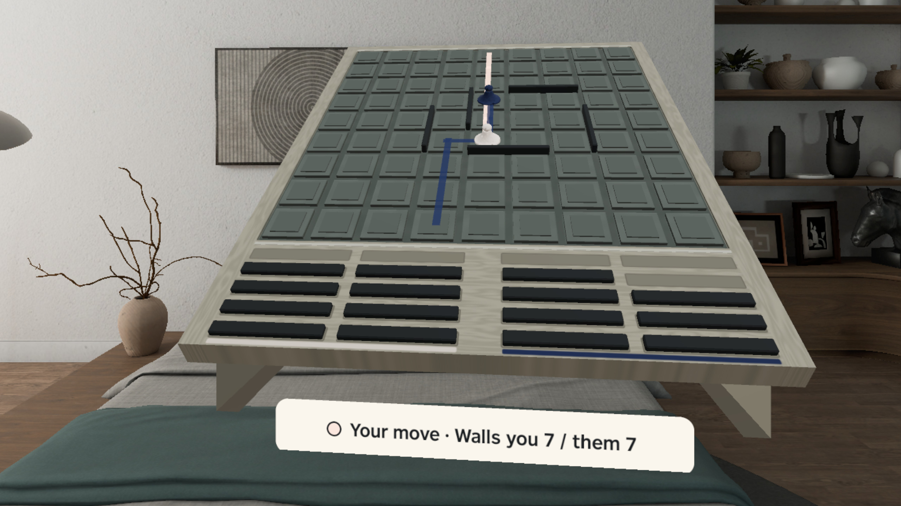 Mid game: two shortest-path bands show how far each side still has to go | 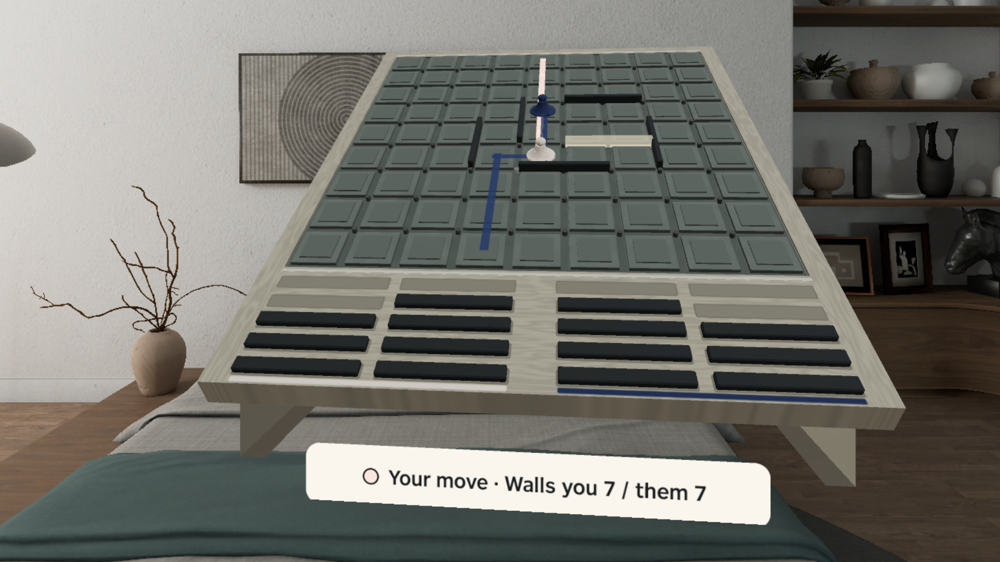 Tap your tray to take a wall, tap a groove for a green preview |
| 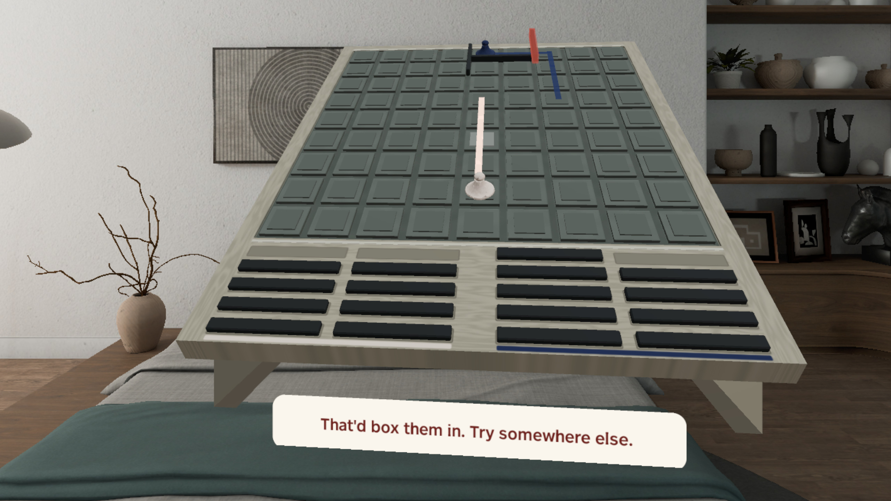 This wall would shut the opponent in: it turns red and bounces back | 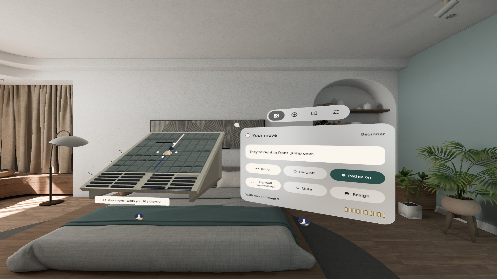 Your pawn selected: the opponent is right in front, so you can jump |
| 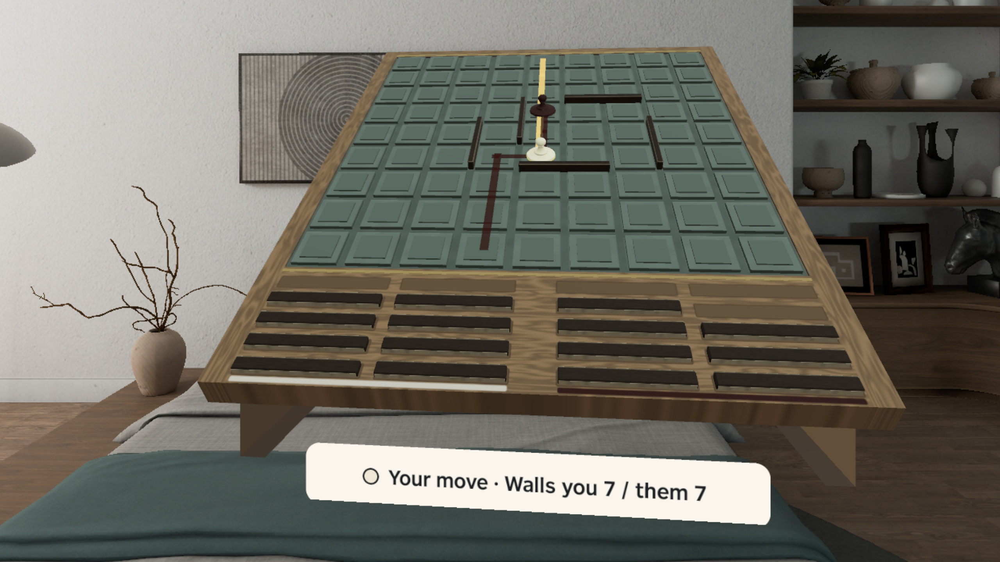 Classic skin: celadon cells, ivory / cinnabar pawns, walnut walls | 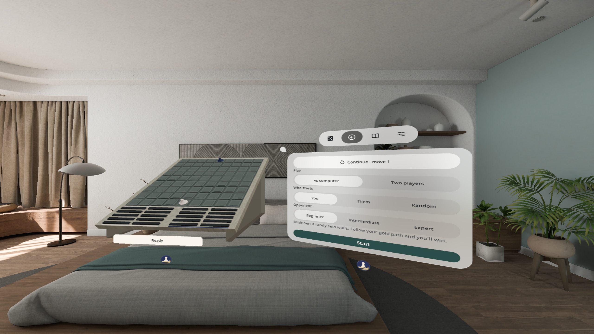 New game: three computer levels, or two players on one headset |

Screenshots were taken on the emulator; 3D input was driven by debug broadcasts, **not a recording of real hand input**.

### How to play

- Tap a lit cell to step; when the opponent is right in front you can jump over (diagonally if a wall is behind them)
- Tap your tray to pick up a wall: every groove lights up; tap one to preview (green = fits, red = not allowed), tap again or press [Set wall] to stand it; [Flip wall] turns it; you can also hold the tray and drag
- Computer at Beginner / Intermediate / Expert, or two players on one headset (or play yourself)
- Undo, hints, a guided first game; the game is saved on exit and comes back next time
- Two skins (modern / classic), mid-tone matte PBR lit by the system environment light
- Pinch, gaze + pinch and controller ray all work; Chinese and English; fully offline, no account

### Install

The APK on the Release is the unsigned `assembleRelease` build (for store upload). To sideload, sign it first or build a debug APK from source:

```bash
export JAVA_HOME=~/.pico/primer-cli/jdk/jdk-21.0.13+9/Contents/Home   # any JDK 17+
./gradlew assembleDebug
adb install -r app/build/outputs/apk/debug/app-debug.apk
pico-cli app launch io.embodit.quoridorwalls
```

Known issues: mark-to-cell contrast in a very dark room was not re-measured; the controller secondary button for turning a wall and dragging a pawn are not built (use [Flip wall] and taps).

## Credits

Rules: Quoridor by Mirko Marchesi (Gigamic); this is an independent implementation. Font: Noto Sans (SIL OFL 1.1). Sounds: Kenney (CC0) and freesound #840425 (CC0).
